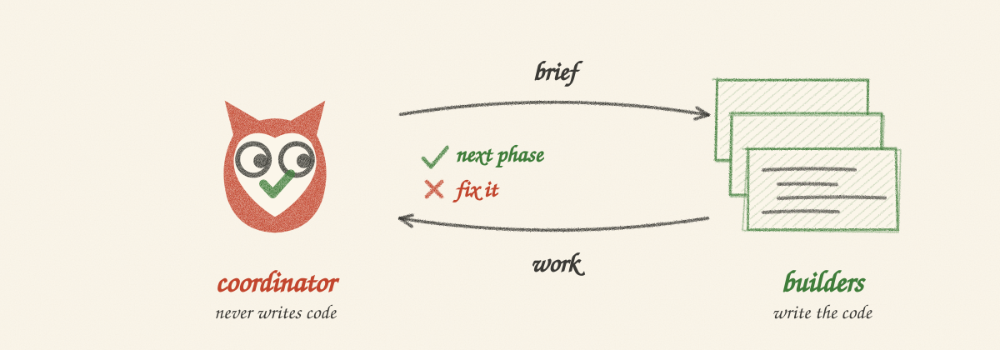

<p align="center">
  
</p>

<h1 align="center">coordinator-mode</h1>

A [Claude Code](https://claude.com/claude-code) skill that turns one session into a **coordinator**: it writes phase briefs, spawns other Claude sessions as **builders** in visible terminal windows, reviews what they push against a checkable contract, sends back the gaps, and launches the next phase.

The coordinator never writes project code. That is the whole point — you keep an independent reviewer that didn't write the thing it's reviewing.

<p align="center">
  
</p>

## Install

**As a Claude Code plugin:**

```
/plugin marketplace add Aankirz/coordinator-mode
/plugin install coordinator-mode
```

**npx** (not published to npm yet, so this doesn't work until it is):

```bash
npx coordinator-mode            # installs to ~/.claude/skills/
npx coordinator-mode --project  # installs to ./.claude/skills/ for this repo only
```

**Manual:**

```bash
git clone https://github.com/Aankirz/coordinator-mode
mkdir -p ~/.claude/skills
cp -r coordinator-mode/skills/coordinator-mode ~/.claude/skills/
```

## Use

Start a Claude Code session in your project and say:

> coordinator mode — orchestrate the phases in `docs/phases/`

Or: "spawn a builder for phase 2", "review the builder's work", "launch phase 3".

## Spawning builders

`spawn-builder.sh` ships inside the skill folder, not your project. The coordinator calls it through `${CLAUDE_SKILL_DIR}`. To run it by hand, use its installed path:

| Installed via | Script path |
|---|---|
| `~/.claude/skills/` (npx or manual) | `~/.claude/skills/coordinator-mode/spawn-builder.sh` |
| `--project` | `./.claude/skills/coordinator-mode/spawn-builder.sh` |
| plugin | a versioned cache directory; ask the coordinator to print `${CLAUDE_SKILL_DIR}` rather than guessing |

It opens a visible terminal window running a Claude session and prints the session id so you can `claude --resume <id>` later. The id means the launch was *requested*; confirm the builder with `ListAgents`. A relative `--brief` path resolves against `--cwd`.

```bash
S=~/.claude/skills/coordinator-mode/spawn-builder.sh
$S --cwd ~/code/myproject --model opus --brief docs/phases/phase-2.md
$S --dry-run --prompt "build phase 1"   # show what it would run
```

Auto-detects WezTerm, Ghostty, kitty, Alacritty, iTerm2, Terminal.app, gnome-terminal, konsole and xterm, and falls back to a detached tmux session. Override with `BUILDER_TERMINAL=kitty`. Extra Claude flags go in `BUILDER_CLAUDE_ARGS`.

Nothing is hardcoded to one terminal, one OS, or one project.

## What a phase brief needs

| Section | Why |
|---|---|
| **Build** | Scope, file by file where possible |
| **Not in this phase** | The fence. Builders respect an explicit one. |
| **Done when** | Numbered, observable, checkable. This is the contract you review against. |
| **Sources of truth** | Docs to cite — *look it up, never invent an API or model id* |
| **The gate** | The exact lint/type/test command to run before pushing |
| **Branch policy** | Direct-to-main or PR-per-phase |
| **OWNER NEEDED protocol** | How a builder escalates a check only a human can run |
| **Messaging protocol** | The coordinator's session name, `READY phase-N`, `DONE phase-N` + hand-off report |
| **Starting point** | The branch or commit the phase builds on |

A complete, copyable example: [`examples/phase-2.md`](examples/phase-2.md).

## Why it works

A builder's ✅ is a claim, not evidence. The coordinator runs the gate itself, reads the diff, and walks the "Done when" list item by item — marking each one verified by it, or as needing the human. A phase isn't done because a session said so.

## License

MIT
